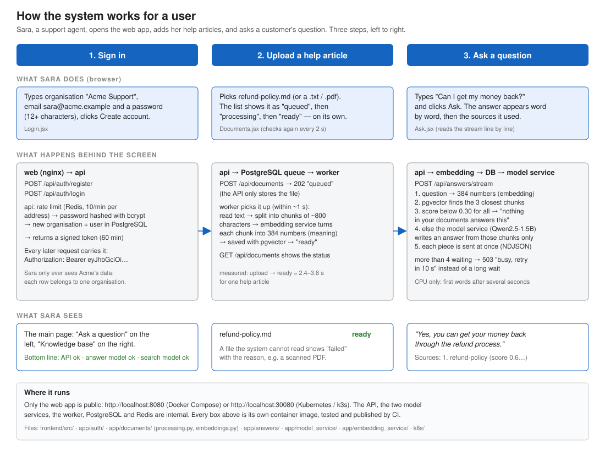
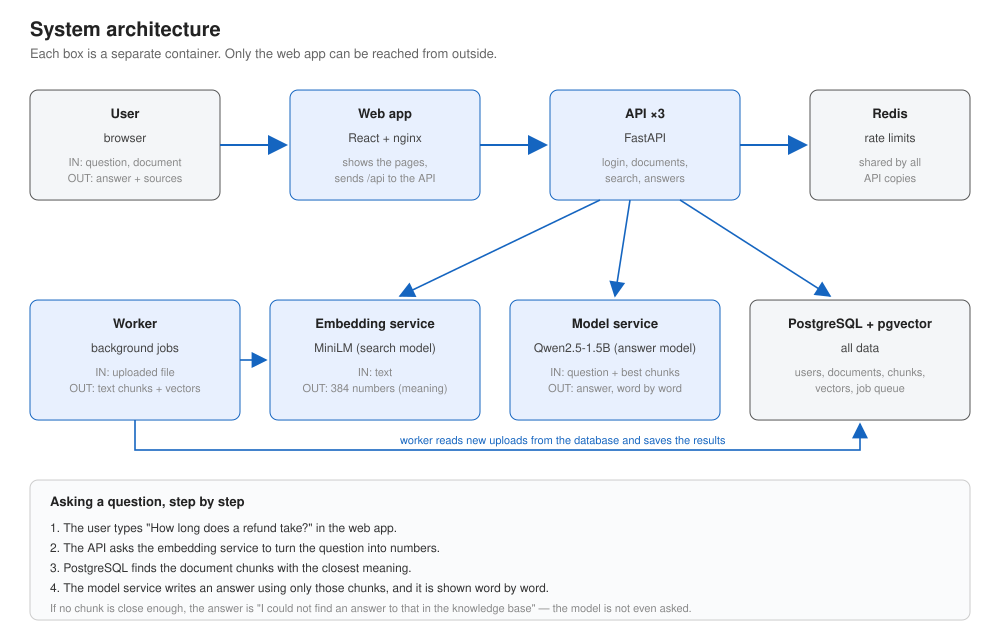
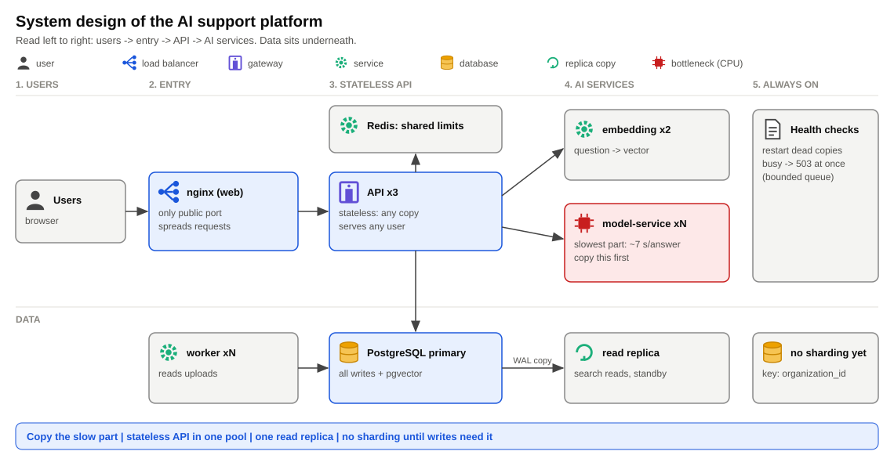
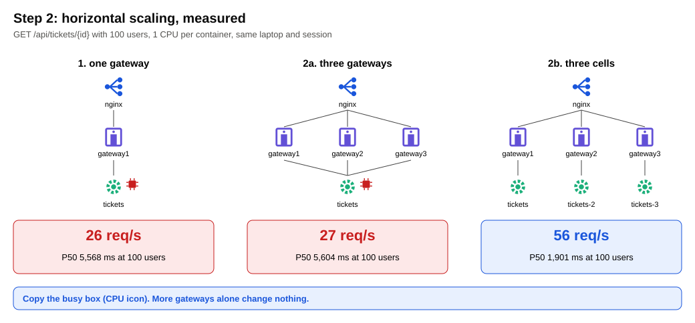
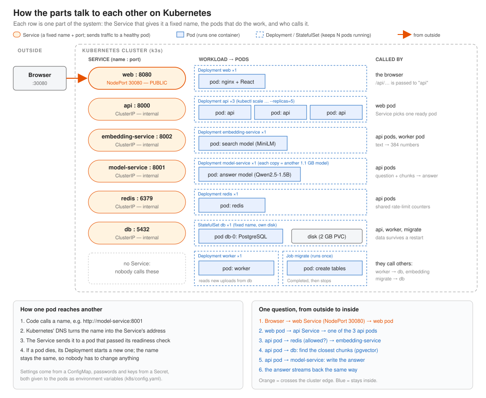
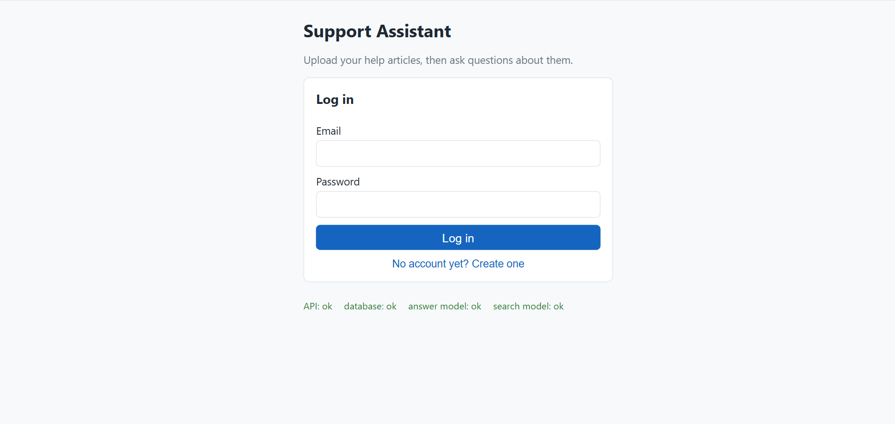
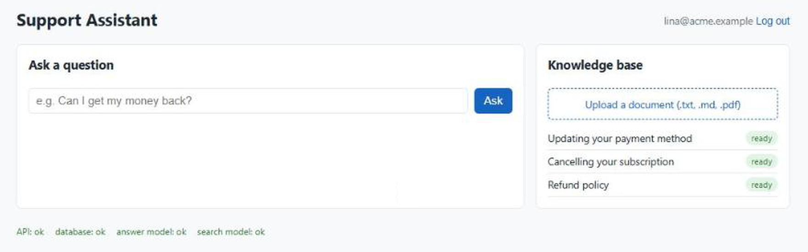
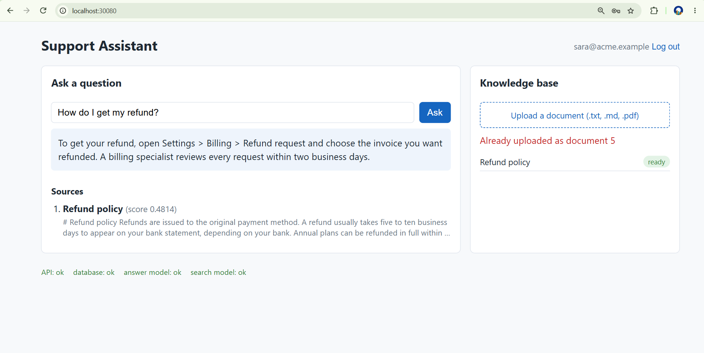
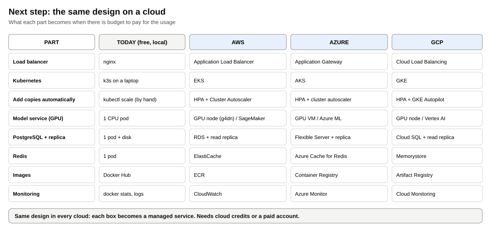

# AI Support Platform

A support assistant that answers customer questions from a company's own help articles. You upload the articles. When a customer asks something, the assistant finds the right passages, writes a short answer from them only, and shows where the answer came from. If the articles don't contain an answer, it says so instead of guessing.

It runs entirely on free, local AI models, with no paid AI service.

| Area | In short |
|---|---|
| **For a support team** | Faster, consistent answers to repeated questions, always backed by a source |
| **AI** | Search by meaning (MiniLM embeddings + pgvector) and answers from a small local language model (Qwen2.5-1.5B) |
| **Engineering** | Separate services in Docker containers, run by Kubernetes, tested and published by CI |
| **Status** | Finished and runs locally. 19 versions (v0-v18), each one fixing a measured problem |

---

## 1. How it works for a user



## 2. Architecture



## 3. How it scales, and why this design



Every choice above was measured first, in a small [system design lab](system-design/README.md). In the lab each container gets 1 CPU, and every setup gets the same load test:



| Decision | Why |
|---|---|
| Copy the **slowest part** first (the answer model) | Adding gateways alone changed nothing (26 → 27 req/s). Copying the busy service doubled throughput (56 req/s) and cut the median wait from 5.6 s to 1.9 s. |
| Keep the **API stateless**, as a pool behind one entry point | Any copy can serve any user, so copies can be added or lost without breaking anything. |
| **One read replica**, on its own machine | A replica takes search reads off the main database and can take over if it fails. On one laptop it gave no gain, because it had no hardware of its own. |
| **No sharding** yet | Writes were not the bottleneck: two shards gave 61 vs 58 req/s, but every query would then need a shard key. |
| Say **"busy" early** | Once every model copy is working, an extra request gets a quick 503 instead of a minutes-long wait. |

**When something fails:**
- A crashed copy is restarted by Kubernetes. When one of the 3 API pods was deleted, 40 of 40 requests still succeeded.
- An upload stays queued until the worker is back.
- If the answer model is down, the API says so instead of hanging.

## 4. Running on Kubernetes



## 5. The web app

<table>
<tr>
<td width="33%"><b>1. Log in</b><br></td>
<td width="33%"><b>2. Upload a help article</b><br></td>
<td width="33%"><b>3. Ask a question</b><br></td>
</tr>
</table>

## 6. Run it

You only need [Docker Desktop](https://www.docker.com/products/docker-desktop/). The images come from Docker Hub, so you don't need to clone the repository.

```bash
curl -O https://raw.githubusercontent.com/ubaidur404786/ai-support-platform/main/docker-compose.hub.yml
JWT_SECRET_KEY=$(openssl rand -hex 32) docker compose -f docker-compose.hub.yml up -d
```

Open **http://localhost:8080**. The first start downloads about 4.5 GB, because the two models are inside the images. To stop it, run `docker compose -f docker-compose.hub.yml down`.

On Kubernetes: `kubectl apply -k k8s`.

## 7. Final remarks

- **Built by measuring, not guessing.** Every version started from a measured problem, for example "listing tickets took 2.2 s" or "the first search took 21 s", and ended with a number after the fix.
- **Scale what is slow.** The lab showed that adding copies of the wrong part costs money and changes nothing.
- **Honest limits:**
  - On a laptop CPU, an answer takes about 7 s, and one model copy handles 5-10 answers a minute.
  - Replicas and shards were tested only on one machine.
  - Wrong answers are not yet detected while the system runs.

## 8. What could come next



With cloud credits or a budget for usage, the same design moves to **AWS, Azure or GCP**:
- managed Kubernetes that adds copies automatically
- GPU machines for the answer model
- a managed PostgreSQL with a read replica
- monitoring

Other next steps:
- a cache for repeated questions
- checking answers for mistakes while the system runs
- a monitoring dashboard
- a safe way to roll out a new model and compare it with the old one

## 9. The full story

How the project started as one small file, what went wrong at each step, and every decision with its numbers:

**[docs/ - the journey, version by version](docs/README.md)**

---

### Develop and test

```bash
git clone https://github.com/ubaidur404786/ai-support-platform.git
cd ai-support-platform
cp .env.example .env        # then set JWT_SECRET_KEY in .env
docker compose up -d --build
pip install -r requirements.txt && python ml/train.py && pytest
```

GitHub Actions runs the tests on every push. The tests are numbered by the version that added them ([tests/README.md](tests/README.md)).

```
app/             backend, one folder per feature (auth, documents, answers, model_service, embedding_service)
frontend/        React web app
docker/          one Dockerfile per service
k8s/             Kubernetes files
system-design/   the scaling lab: nginx, gateways, replicas, shards, load tests, charts
tests/           tests, numbered by version
docs/            the journey: versions, diagrams, decisions
```
