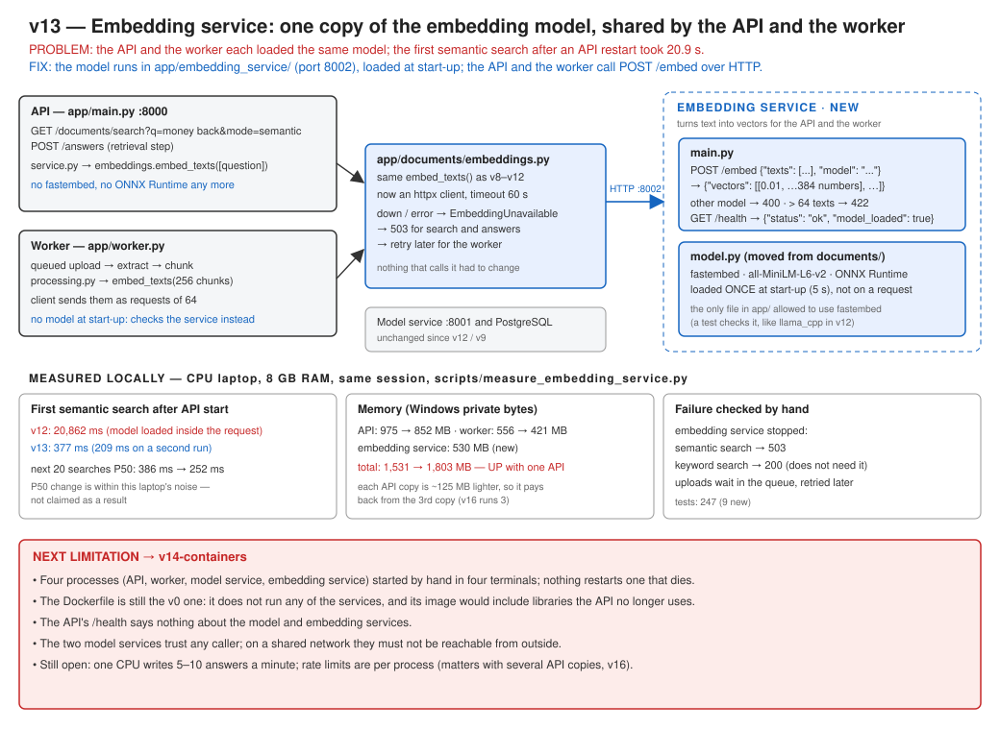

# v13: Embedding service

The API (for search questions) and the worker (for document chunks) each loaded the same embedding model. The first semantic search after a restart took 20.9 s, because the API was loading the model inside that request. v13 moves the model into its own small service, which both of them call over HTTP. It is the same pattern as v12's model service.



## What this version adds

- `app/embedding_service/`, with two endpoints:
  - `GET /health`
  - `POST /embed`: `{"texts": [...], "model": "..."}` → `{"vectors": [...]}`
- `app/documents/embeddings.py` is now an HTTP client. `embed_texts()` works the same as before.
- 9 new tests, including a check that only the embedding service uses fastembed.

## Run

You need four terminals:

```bash
uvicorn app.embedding_service.main:app --port 8002
```

```bash
uvicorn app.model_service.main:app --port 8001
```

```bash
uvicorn app.main:app --port 8000
```

```bash
python -m app.worker
```

## Test

```bash
pytest tests/test_embedding_service.py -v
```

```bash
python scripts/measure_embedding_service.py
```

## Results (measured locally, CPU laptop, same session)

| | v12 | v13 |
|---|---|---|
| First semantic search after API start | 20,862 ms | 377 ms |
| API / worker memory | 975 / 556 MB | 852 / 421 MB |
| Embedding service | – | 530 MB |
| Total | 1,531 MB | 1,803 MB |

The total memory is higher with one API process. Each extra API copy now costs about 125 MB less, so the saving appears once Kubernetes runs several copies (v16).

## Documents

- Full version document: [v13-embedding-service.md](../v13-embedding-service.md)
- [ADR-033: A separate embedding service](../../adr/ADR-033-separate-embedding-service.md)
- Previous version: [v12: Model service](../v12-model-service.md)
