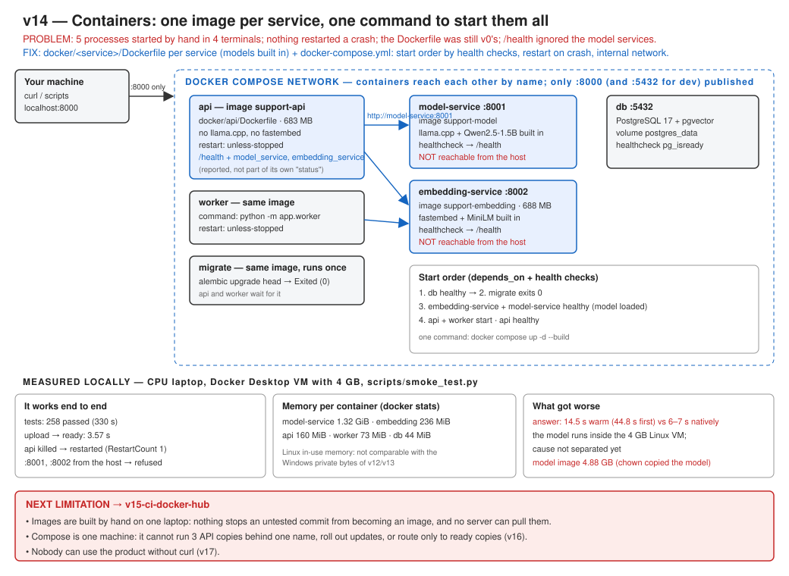

# v14: Containers

Five processes used to be started by hand in four terminals, and nothing restarted one that crashed. v14 gives every service its own Docker image, with only its own libraries and its model built in, and starts everything with one command. The API's `/health` now also reports both model services.



## Run

Put `JWT_SECRET_KEY` in `.env` (Compose reads it from there).

```bash
docker compose up -d --build
```

```bash
docker compose ps
```

```bash
curl http://localhost:8000/health
```

Expected response:

```json
{"status": "ok", "model_loaded": true, "database_reachable": true, "model_service": "ok", "embedding_service": "ok", ...}
```

Stop everything (the database volume is kept):

```bash
docker compose down
```

## Test

```bash
pytest
```

```bash
python scripts/smoke_test.py http://localhost:8000
```

## Results (measured locally, Docker Desktop with 4 GB)

| | |
|---|---|
| Tests | 258 passed |
| Start to all healthy | about 1 min |
| Answer in Docker (warm) | 14.5 s (6–7 s as a Windows process: slower in the VM, cause not separated) |
| Model service / embedding / API / worker memory | 1.32 GiB / 236 MiB / 160 MiB / 73 MiB |
| Ports 8001, 8002 from the host | not reachable |
| API killed | restarted automatically |

## Documents

- Full version document: [v14-containers.md](../v14-containers.md)
- [ADR-034: One image per service, with the models built in](../../adr/ADR-034-one-image-per-service.md)
- Previous version: [v13: Embedding service](../v13-embedding-service.md)
