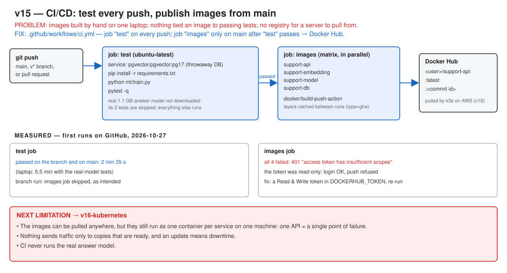

# v15: CI and Docker Hub

Images used to be built by hand on one laptop, and nothing tied them to a passing test run. Now GitHub Actions runs the tests on every push. On `main`, once the tests pass, it builds every service image and pushes it to Docker Hub as `:latest` and `:<commit id>`.



## Set up

Add these repository secrets under **Settings → Secrets and variables → Actions**:

- `DOCKERHUB_USERNAME`
- `DOCKERHUB_TOKEN` (a Docker Hub access token with **Read & Write** access)

## Check it

```bash
gh run list --limit 3
```

## Results (first runs)

| | |
|---|---|
| Tests on GitHub's runner | passed, 2 min 35 s |
| Image push | failed: the first token was read-only (`insufficient scopes`) |

## Documents

- Full version document: [v15-ci-docker-hub.md](../v15-ci-docker-hub.md)
- [ADR-036: GitHub Actions and Docker Hub](../../adr/ADR-036-ci-and-docker-hub.md)
- Previous version: [v14: Containers](../v14-containers.md)
