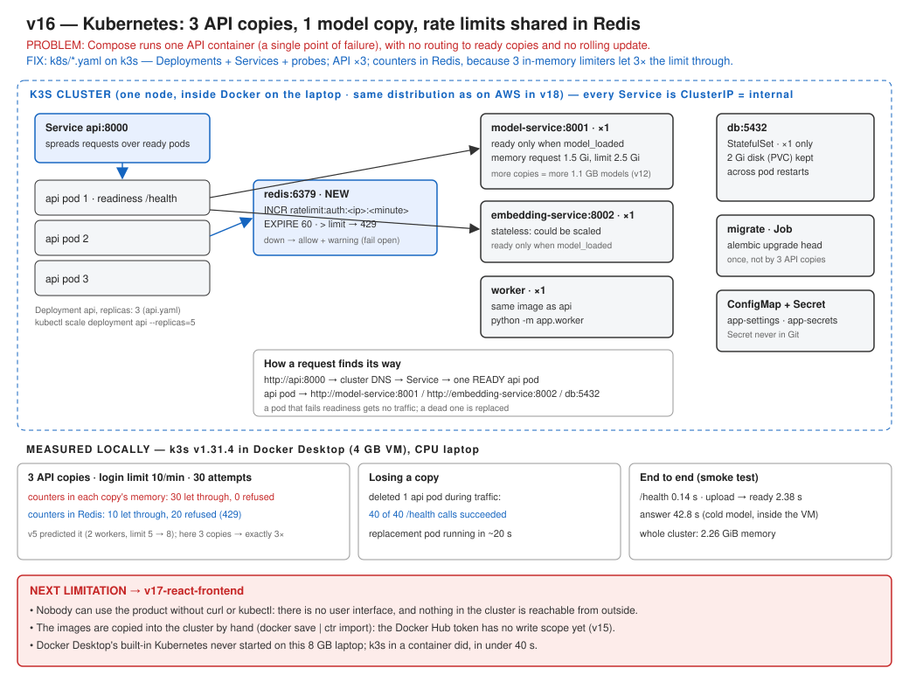

# v16: Kubernetes

v14's containers now run on Kubernetes (k3s). The API runs as 3 copies behind one Service, and readiness probes decide which copy gets traffic. The model service stays at 1 copy, and the database is a StatefulSet with its own disk. Running 3 copies broke the rate limit the way v5 predicted (30 of 30 logins got through a limit of 10), so the counters moved to Redis (10 of 30).



## Run

Follow [k8s/README.md](../../../k8s/README.md). In short:

```bash
docker run -d --name k3s --privileged -p 6444:6443 -p 30080:30080 rancher/k3s:v1.31.4-k3s1 server --disable traefik --disable metrics-server
```

Then import the images, create the Secret, and apply:

```bash
kubectl apply -k k8s
```

## Test

```bash
pytest tests/test_v16_redis_rate_limit.py -v
```

```bash
python scripts/measure_shared_rate_limit.py http://localhost:30080/api
```

## Results (measured locally, k3s in Docker, CPU laptop)

| 3 API copies, login limit 10/min | Let through of 30 |
|---|---|
| Counters in each copy's memory | 30 |
| Counters in Redis | 10 |

| | |
|---|---|
| One API pod deleted, 40 health checks | 40 succeeded |
| Cluster memory (all pods) | 2.26 GiB |

## Documents

- Full version document: [v16-kubernetes.md](../v16-kubernetes.md)
- [ADR-037: Plain Kubernetes files, k3s locally and on AWS](../../adr/ADR-037-kubernetes-plain-manifests.md)
- [ADR-038: Shared rate limits in Redis](../../adr/ADR-038-shared-rate-limits-in-redis.md)
- Previous version: [v15: CI and Docker Hub](../v15-ci-docker-hub.md)
