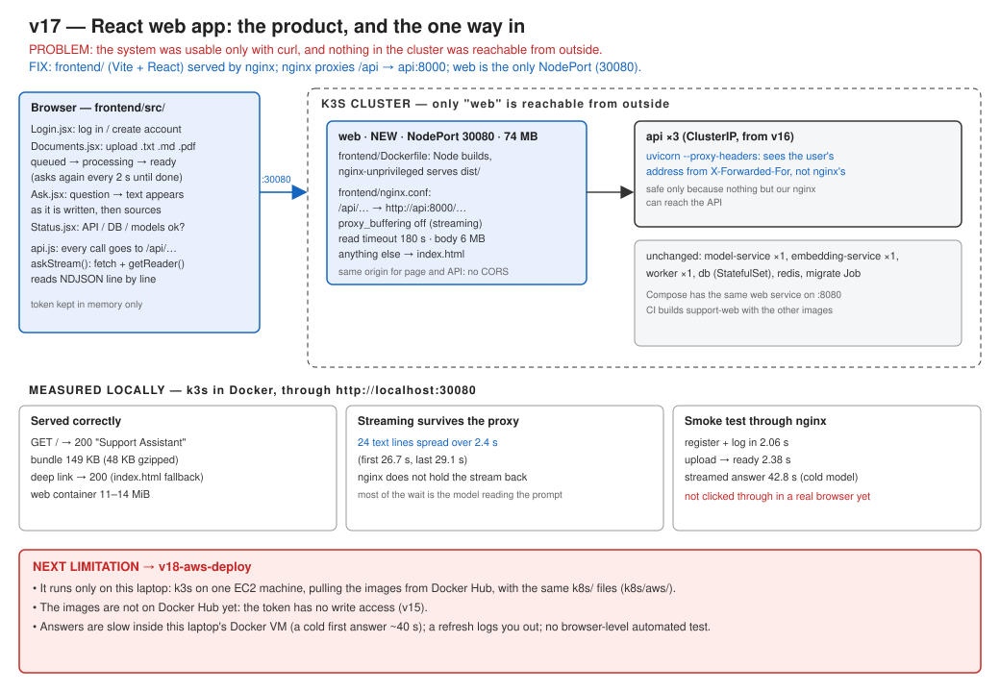

# v17: React web app

Until now the system could only be used with curl, and nothing in the Kubernetes cluster could be reached from outside. v17 adds a small React app (log in, upload documents, ask questions with streamed answers), served by nginx. The same nginx forwards `/api` to the API, so the web app is the only public entry point.



## Run

```bash
docker compose up -d --build
```

Open http://localhost:8080. On Kubernetes, open http://localhost:30080 (see [k8s/README.md](../../../k8s/README.md)).

For development, with the API on :8000:

```bash
cd frontend
npm install
npm run dev
```

## Test

```bash
python scripts/smoke_test.py http://localhost:30080/api
```

## Results (measured locally, k3s in Docker)

| | |
|---|---|
| Page and bundle served | 200, 149 KB of JS (48 KB gzipped) |
| Streaming through nginx | 24 pieces over 2.4 s, not buffered |
| Web container | 11–14 MiB, image 74 MB |

## Documents

- Full version document: [v17-react-frontend.md](../v17-react-frontend.md)
- [ADR-035: One public entry point](../../adr/ADR-035-one-public-entry-point.md)
- [ADR-039: A React app behind nginx](../../adr/ADR-039-react-web-app-behind-nginx.md)
- Previous version: [v16: Kubernetes](../v16-kubernetes.md)
