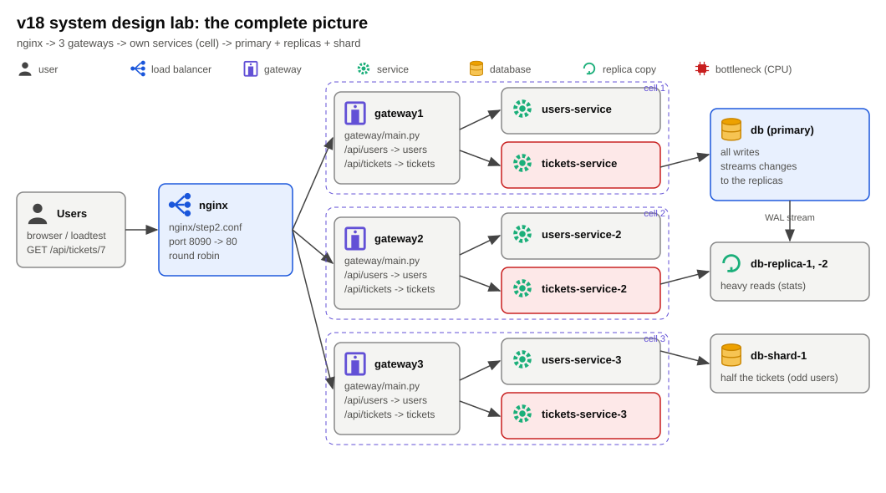
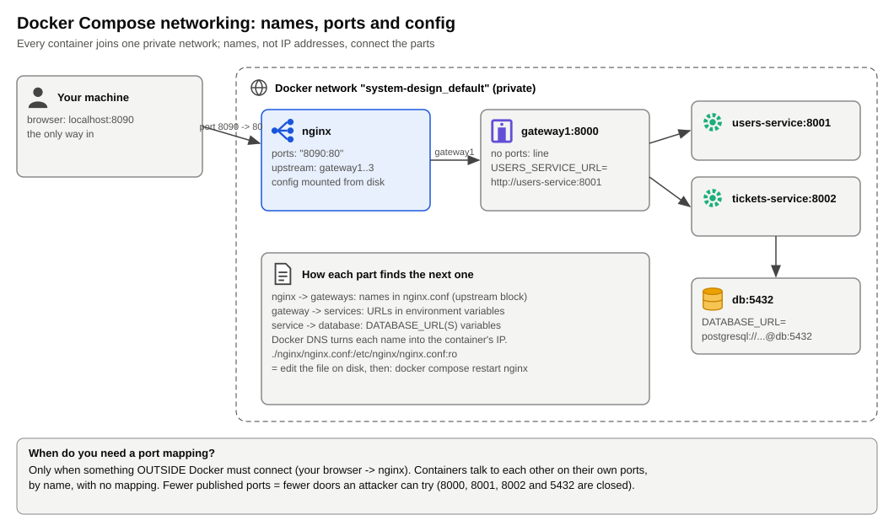
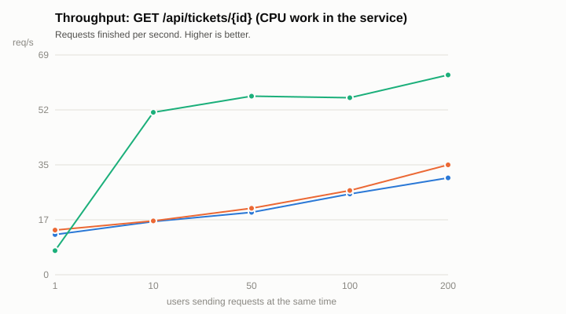
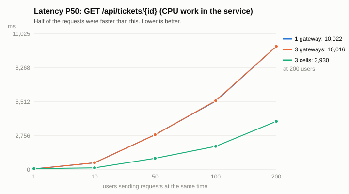
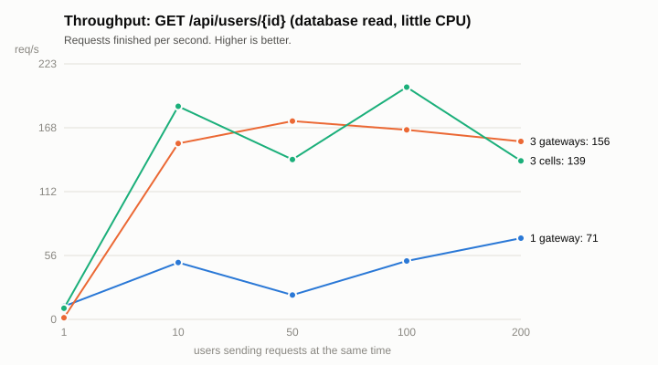
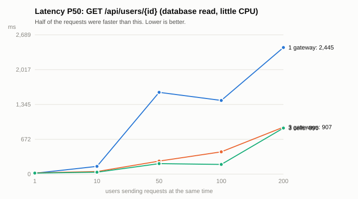
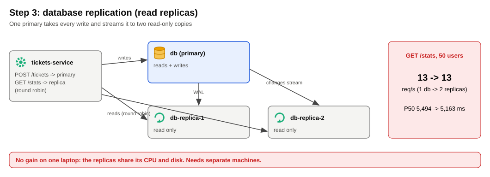
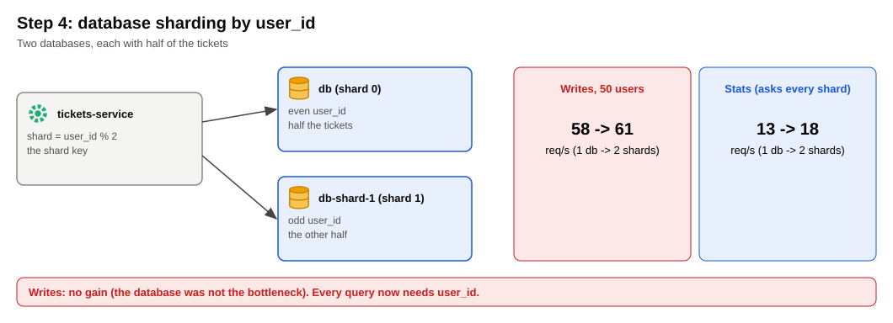
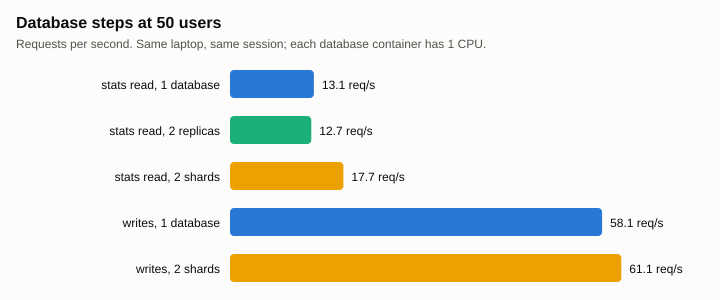

# v18 System design lab

nginx → gateways → services → PostgreSQL, scaled step by step and measured. Each container gets 1 CPU, and every setup gets the same load test.

## Diagrams

<table>
<tr>
<td width="50%"><b>1. The complete picture</b><br></td>
<td width="50%"><b>2. How the containers find each other</b><br></td>
</tr>
<tr>
<td colspan="2"><b>3. Steps 1 and 2: one gateway → three gateways → three cells (measured)</b><br></td>
</tr>
<tr>
<td><b>4. Throughput, tickets (service-bound)</b><br></td>
<td><b>5. Latency, tickets</b><br></td>
</tr>
<tr>
<td><b>6. Throughput, users (gateway-bound)</b><br></td>
<td><b>7. Latency, users</b><br></td>
</tr>
<tr>
<td><b>8. Step 3: read replicas</b><br></td>
<td><b>9. Step 4: sharding</b><br></td>
</tr>
<tr>
<td><b>10. Database steps compared</b><br></td>
<td><b>11. The design chosen for the platform</b><br></td>
</tr>
</table>

## Run

```bash
cd system-design
docker compose up -d --build                                             # step 1
docker compose -f docker-compose.yml -f step2-gateways.yml up -d         # 2a: 3 gateways
docker compose -f docker-compose.yml -f step2-gateways.yml -f step2-cells.yml up -d   # 2b: 3 cells
docker compose -f docker-compose.yml -f step3-replicas.yml up -d         # 3: replicas
docker compose -f docker-compose.yml -f step4-shards.yml up -d           # 4: shards
sh run_experiments.sh && python plot_results.py                          # every test + charts (~20 min)
docker compose down -v
```

Explanations, the numbers behind every diagram, and how to scale by hand: [docs/system-design-details.md](../docs/system-design-details.md)
