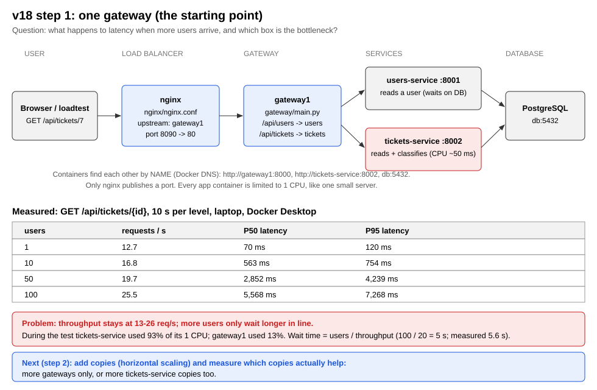

# v18 System design lab

A small, separate system for learning **how and why an architecture changes when the number of users grows**. It has no AI model, so the answers are fast and the experiments run in seconds. A fixed amount of CPU work in `tickets-service` stands in for the model.

It is built step by step. Each step changes one thing and measures it.

| Step | Change | Status |
|---|---|---|
| 1 | One gateway: nginx → gateway1 → services → PostgreSQL | done |
| 2 | Horizontal scaling: 3 gateways, then more service copies | next |
| 3 | Database replication (reads go to a copy) | planned |
| 4 | Sharding (data split across databases) | planned |

## Step 1: one gateway



### The parts

| Container | File | Job |
|---|---|---|
| nginx | `nginx/nginx.conf` | Load balancer, the only door from outside (port 8090) |
| gateway1 | `gateway/main.py` | Reads the path and forwards to the right service |
| users-service | `services/users/main.py` | Reads users; mostly waits on the database |
| tickets-service | `services/tickets/main.py` | Reads a ticket and classifies it (~50 ms of CPU) |
| db | `db/init.sql` | PostgreSQL with 1,000 users and 10,000 tickets |
| loadtest | `loadtest/loadtest.py` | Simulated users; runs only when you call it |

### Run it

```bash
cd system-design
docker compose up -d --build
curl -i http://localhost:8090/api/tickets/7
```

The answer has `X-Gateway: gateway1` and `"served_by": "tickets-service"`, so you can see which copy answered.

### Measure it

```bash
docker compose run --rm loadtest python loadtest/loadtest.py --path /api/tickets --users 1,10,50,100
```

In Git Bash on Windows, put `MSYS_NO_PATHCONV=1` before the command. Without it, Git Bash turns `/api/tickets` into a Windows path.

To see which container is busy, run this in a second terminal while the test runs:

```bash
docker stats --no-stream
```

### Result (laptop, Docker Desktop, 1 CPU per app container, 15 s per level)

`GET /api/tickets/{id}`:

| Users | Requests/s | P50 | P95 |
|---|---|---|---|
| 1 | 14.5 | 61 ms | 94 ms |
| 10 | 20.5 | 495 ms | 590 ms |
| 50 | 20.8 | 2,605 ms | 3,542 ms |
| 100 | 24.6 | 5,165 ms | 6,075 ms |

During the 50-user test, `docker stats` showed **tickets-service at 93% CPU** and gateway1 at 13%.

**What this means:**
- The system can finish about 20 requests per second, because one tickets-service process does one classification at a time.
- Extra users do not get more work done; they only wait in line. Wait ≈ users ÷ throughput: 100 ÷ 20 = 5 s, which matches the measured P50.
- The bottleneck is the service, not the gateway. Step 2 shows what that means for scaling.

**A limit of the measuring tool:** on `/api/users` the load-test container itself used ~96% of a CPU (one Python process), so those numbers measure the client as much as the system. They are saved in `results/` but not used for conclusions.

### How the containers talk (Docker Compose networking)

- Compose puts every container on **one private network**. A container reaches another by its **service name**: the gateway calls `http://tickets-service:8002`, and a service connects to `db:5432`. Docker's built-in DNS turns the name into the container's IP address.
- **Port mapping** (`ports: "8090:80"`) is only needed for something **outside** Docker, such as your browser. Only nginx has one. The gateway and services have none, so nobody outside can call them directly.
- **nginx finds the gateways** through the `upstream gateways { server gateway1:8000; }` block in `nginx.conf`. The file is on your disk and mounted into the container (`./nginx/nginx.conf:/etc/nginx/nginx.conf:ro`), so you change it without rebuilding anything.
- **The gateway finds the services** through environment variables in `docker-compose.yml` (`TICKETS_SERVICE_URL=http://tickets-service:8002`). Its route table maps the first part of the path to a URL.

### Stop

```bash
docker compose down -v
```
